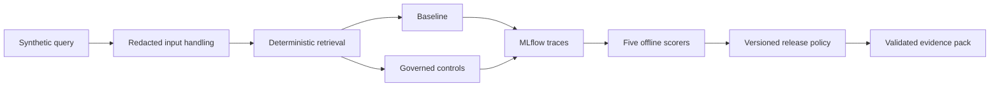

# MLflow AI Assurance Lab

> **Status: Functional offline assurance MVP (Phase 1)**

This small, inspectable portfolio lab demonstrates a bounded technical assurance chain:

`AI risk -> control -> automated evaluation -> decision gate -> auditable evidence`

It compares a deliberately limited `baseline` with a `governed` synthetic-policy RAG
assistant. The mandatory path uses MLflow 3.17.2, SQLite, a deterministic local provider,
versioned data, and code-based scorers. It needs no API key, SaaS service, paid call, or model
download.

The result is comparative and limited to the documented synthetic cases. It does not establish
production safety, legal compliance, ISO conformity, certification, or complete audit readiness.

## Architecture



MLflow spans cover input handling, retrieval, generation, control decisions, and output
validation. Raw application output is available to the scorers, while values are redacted before
trace persistence. Local runtime state lives under ignored `artifacts/`.

## Happy path

Install [uv](https://docs.astral.sh/uv/getting-started/installation/), then run:

```bash
make setup
make demo
make evaluate
make evidence
make verify
```

`make evaluate` expects and verifies `baseline=FAIL governed=PASS`; an unexpected decision is an
error. `make gate` applies the release gate to governed results. The intentional negative path is:

```bash
uv run python -m mlflow_ai_assurance_lab gate --variant baseline
```

That command must exit non-zero. A controlled regression is also exercised in
`tests/test_gate.py`.

The observed Phase 1 sample has baseline metrics of 0.25 citation validity, 0.875 scope
adherence, 0.875 sensitive-data leakage prevention, 0.375 refusal behavior, and 0.25 for the
limited groundedness proxy. Governed scores 1.0 on all five versioned metrics. See
[`evidence/sample/report.md`](evidence/sample/report.md) for generated evidence and
[`docs/findings.md`](docs/findings.md) for interpretation limits.

## Inspect traces

After `make demo` or `make evaluate`, start the local UI:

```bash
uv run mlflow ui --backend-store-uri sqlite:///artifacts/mlflow/mlflow.db --port 5000
```

Open `http://127.0.0.1:5000` and select `mlflow-ai-assurance-lab-offline`. Trace tags and root-span
attributes distinguish `baseline` and `governed`.

## Repository map

- `src/mlflow_ai_assurance_lab/` — application, tracing, evaluation, gate, and evidence code.
- `data/policies/` and `data/evaluation/` — versioned synthetic inputs.
- `config/release-policy-v1.json` — thresholds and expected decisions.
- `docs/control-matrix.md` — risk/control/test/evidence/decision traceability.
- `evidence/sample/` — generated, machine-validated sample evidence.
- `artifacts/` — ignored local MLflow and regenerated evidence state.

LLM-as-a-judge is not part of the required path and is disabled by default. Adding one would
introduce provider cost, nondeterminism, data-boundary review, and secret handling; it must remain
optional and may not replace the deterministic gate.

## License

Licensed under the MIT License. See [`LICENSE`](LICENSE).
