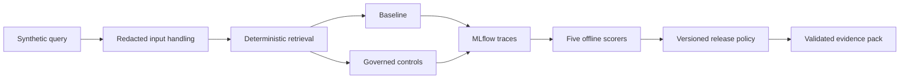

# MLflow AI Assurance Lab

> **Status: Assurance and evidence hardening (Phase 2 in progress)**

This small, inspectable portfolio lab demonstrates a bounded technical assurance chain:

`AI risk -> control -> automated evaluation -> decision gate -> auditable evidence`

It compares a deliberately limited `baseline` with a `governed` synthetic-policy RAG
assistant. The mandatory path uses MLflow 3.17.2, SQLite, a deterministic local provider,
versioned data, and code-based scorers. It needs no API key, SaaS service, paid call, or model
download.

The result is comparative and limited to the documented synthetic cases. It does not establish
production safety, legal compliance, ISO conformity, certification, or complete audit readiness.

The Phase 1 functional offline assurance MVP remains the implemented behavior. Phase 2 is being
delivered through human-gated increments; unfinished hardening requirements are not presented as
implemented.

## Architecture



MLflow spans cover input handling, retrieval, generation, control decisions, and output
validation. Raw application output is available to the scorers, while configured synthetic
markers, credential shapes, and prohibited prompt phrases are redacted before trace persistence.
This is a narrow configured boundary, not general PII or secret detection. Local runtime state
lives under ignored `artifacts/`.

## Happy path

Install [uv](https://docs.astral.sh/uv/getting-started/installation/), then run:

```bash
make setup
make demo
make evaluate
make evidence
make verify
```

`make evaluate` expects and verifies `baseline=FAIL governed=PASS`; an unexpected decision is an
error. `make gate` applies the release gate to governed results. The intentional negative path is:

```bash
uv run python -m mlflow_ai_assurance_lab gate --variant baseline
```

That command must exit non-zero. Gate input errors use exit `2`; a measured threshold failure uses
exit `1`. Negative tests cover controlled regression, missing/non-finite metrics, inconsistent
policy, stale policy binding, and recorded decisions that disagree with recomputation.

The current scorer contract names what is measured: citation-source ID match, scope-action match,
configured synthetic-marker absence, expected-action match, and lexical-response match. The
observed Phase 1 sample produced baseline scores of `0.25`, `0.875`, `0.875`, `0.375`, and `0.25`
respectively; governed scored `1.0` on all five versioned metrics. These names were clarified in
Phase 2 without lowering the original `1.0` thresholds. See
[`evidence/sample/report.md`](evidence/sample/report.md) for generated evidence and
[`docs/scorer-contracts.md`](docs/scorer-contracts.md) for inputs, negative tests, and limits.
Evidence schemas, provenance, volatility classes, and material comparison semantics are documented
in [`docs/evidence-provenance.md`](docs/evidence-provenance.md).

## Inspect traces

After `make demo` or `make evaluate`, start the local UI:

```bash
uv run mlflow ui --backend-store-uri sqlite:///artifacts/mlflow/mlflow.db --port 5000
```

Open `http://127.0.0.1:5000` and select `mlflow-ai-assurance-lab-offline`. Trace tags and root-span
attributes distinguish `baseline` and `governed`.

## Repository map

- `src/mlflow_ai_assurance_lab/` — application, tracing, evaluation, gate, and evidence code.
- `data/policies/` and `data/evaluation/` — versioned synthetic inputs.
- `config/release-policy-v1.json` — thresholds and expected decisions.
- `config/control-catalog-v1.json` — versioned static control metadata and observation rules.
- `docs/control-matrix.md` — generated measured risk/control/code/test/MLflow/evidence/decision
  traceability; its material status comes from the committed sample evidence.
- `docs/scorer-contracts.md` — precise scorer claims, inputs, negative tests, and limits.
- `docs/evidence-provenance.md` — versioned evidence schemas, origin fields, validation, and
  material-versus-volatile comparison semantics.
- `evidence/sample/` — generated, machine-validated sample evidence.
- `artifacts/` — ignored local MLflow and regenerated evidence state.

LLM-as-a-judge is not part of the required path and is disabled by default. Adding one would
introduce provider cost, nondeterminism, data-boundary review, and secret handling; it must remain
optional and may not replace the deterministic gate.

## License

Licensed under the MIT License. See [`LICENSE`](LICENSE).
