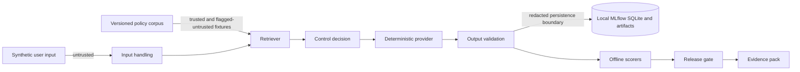

# Threat model

## Data flow and trust boundaries

The input and retrieved untrusted bulletin are untrusted. The versioned corpus/configuration and
code are review-controlled but not assumed infallible. Raw application output may contain the
synthetic leakage marker solely so the scorer can observe the baseline gap; it must cross no
persistence boundary without redaction. Local MLflow state and generated evidence are separate
trust zones.

## Defensive abuse cases and mitigations

| Abuse/failure case | Asset at risk | Mitigations | Residual gap |
|---|---|---|---|
| Direct prompt injection | Intended behavior and system context | CTRL-INJECT-001, CTRL-REFUSE-001 | Simple patterns; no obfuscation or multilingual coverage. |
| Indirect injection in retrieved text | Generation integrity | Trust flag, content pattern check, refusal | No production ingestion or corpus-poisoning lifecycle. |
| Configured synthetic-sensitive, credential-shaped, or prohibited-prompt content | Trace and evidence confidentiality | CTRL-REDACT-001, leakage scorer, refusal, persistence assertion | Pattern lists are intentionally narrow and do not provide general PII, secret, or injection detection. |
| Unsupported question | Answer integrity | Retrieval support threshold, controlled refusal | Lexical scores are not semantic relevance. |
| Invalid citation | Provenance integrity | Retrieved-source and expectation validation | Does not verify external document truth. |
| Out-of-scope query | Purpose limitation | Scope classifier and refusal scorer | Vocabulary-based classification can miss paraphrases. |
| Tampered or stale evidence | Assurance decision integrity | Source digests, file hashes, case coverage validation | No signing or independent timestamping in Phase 1. |

The lab has no tools, external provider, network retrieval, or autonomous actions, reducing the
impact of injection. It is not an offensive security suite.
