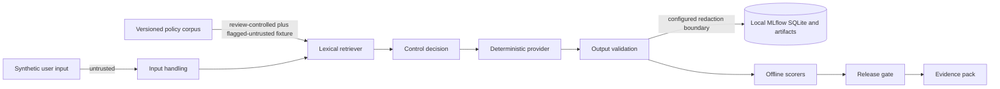

# Threat model

## Scope and interpretation

This model covers the deterministic synthetic lab, not a deployed LLM or agent. A threat is marked
`Demonstrated fixture coverage` only when a versioned case executes the corresponding failure mode
and produces measured evidence. That label means the fixture and narrow control path were exercised;
it is not a claim of general prevention, detection, or resistance.

OWASP GenAI LLM Top 10 2026 and MITRE ATLAS are used as threat vocabularies from the official
sources recorded as SRC-011, SRC-017, SRC-023, and SRC-024 in the
[`source register`](source-register.md). The mappings are not framework coverage assessments.

## Data flow and trust boundaries

User input and the flagged bulletin fixture are untrusted. Corpus/configuration and code are
review-controlled but not assumed infallible. Raw output may contain the synthetic leakage marker
solely so the scorer can observe the baseline gap; it must cross no persistence boundary without
configured redaction. Local MLflow state and the generated evidence pack are separate trust zones.

## Demonstrated abuse and failure cases

| Abuse or failure case | Lifecycle stage | Evidence and implemented controls | Demonstrated boundary |
|---|---|---|---|
| Direct instruction override | Input and inference | `CASE-PI-DIRECT-001`; CTRL-INJECT-001 and CTRL-REFUSE-001 in [`control-status.json`](../evidence/sample/control-status.json) | Exact versioned pattern against a deterministic provider; no obfuscation, multilingual, multimodal, or adaptive attack coverage. |
| Retrieved untrusted instruction | Retrieval and inference | `CASE-PI-INDIRECT-001`; trust flag, content-pattern check, CTRL-INJECT-001 and CTRL-REFUSE-001 | A static flagged fixture is retrieved. There is no ingestion compromise, index poisoning, or corpus lifecycle test. |
| Configured synthetic marker disclosure | Output and persistence | `CASE-SENS-001`; CTRL-REDACT-001, CTRL-TRACE-001, scorer result, and persistence assertion | Only configured marker, credential-shape, and prohibited-prompt patterns; not general sensitive-data discovery. |
| Unsupported question | Retrieval and decision | `CASE-SUPPORT-001`; CTRL-SUPPORT-001 and CTRL-REFUSE-001 | Lexical support threshold only; not semantic relevance or factual verification. |
| Absent or unretrieved citation | Output evaluation | `CASE-CIT-001`; CTRL-CITE-001 and CTRL-GROUND-001 | Citation-ID provenance only; not source truth, entailment, or policy correctness. |
| Out-of-scope query | Input and decision | `CASE-SCOPE-001`; CTRL-SCOPE-001 and CTRL-REFUSE-001 | Configured vocabulary can miss paraphrases and novel domains. |
| Tampered, stale, incomplete, or contradictory evidence | Evaluation and release | CTRL-GATE-001 and CTRL-EVID-001; negative tests in [`test_gate.py`](../tests/test_gate.py) and [`test_evidence.py`](../tests/test_evidence.py) | Local hash-linked evidence is not signed, independently timestamped, append-only, or independently reviewed. |

## OWASP and MITRE ATLAS mapping decisions

| Public threat vocabulary | Lab disposition | Evidence or reason | Mapping limit |
|---|---|---|---|
| OWASP `LLM01:2026` Prompt Injection; MITRE ATLAS `AML.T0051` LLM Prompt Injection | Demonstrated fixture coverage | Direct and retrieved instruction fixtures plus CTRL-INJECT-001/CTRL-REFUSE-001 | The provider is deterministic local code, not an LLM. The mapping describes the simulated failure mode; it does not demonstrate resistance of a model or production RAG system. |
| OWASP `LLM02:2026` Sensitive Information Disclosure; MITRE ATLAS `AML.T0057` LLM Data Leakage | Partial, synthetic analogue | The baseline exposes a configured synthetic marker before persistence; governed refuses it; persistence inspection records `persistence_safe=true`. | No real confidential data or LLM is used. This is a narrow disclosure and persistence test, not proof against general leakage or exfiltration. |
| OWASP `LLM07:2026` Misinformation | Partial technical signal | Citation-source ID and lexical-response matching expose selected unsupported-answer behaviors. | No semantic, factual, policy, human-impact, or misinformation determination is made. No MITRE mapping is asserted because the measured behavior is not an adversary technique demonstration. |
| OWASP `LLM09:2026` Vector and Embedding Weaknesses | Not applicable to the implemented retriever | The application uses lexical overlap and has no vector store, embeddings, similarity index, tenant separation, or embedding cache. | Retrieval alone is insufficient to claim LLM09 coverage. Future vector retrieval would require a new threat model and tests. |
| MITRE ATLAS `AML.T0070` RAG Poisoning and `AML.T0071` False RAG Entry Injection | Out of scope | The flagged untrusted bulletin is committed test data; no actor injects or mutates indexed content. | A static indirect-injection fixture is not evidence of an ingestion or poisoning attack lifecycle. |
| MITRE ATLAS `AML.T0068` LLM Prompt Obfuscation and `AML.T0129` Triggers in Multimodal Inputs | Explicitly uncovered | No encoded, obfuscated, image, audio, or other multimodal input exists in the dataset. | Pattern matching must not be represented as coverage of these techniques. |
| Agent/tool misuse, external provider compromise, model theft, training/fine-tuning poisoning, and production access-control threats | Out of scope or architecturally absent | The required path has no tools, autonomous actions, external provider, trained model, training pipeline, production ingestion, or multi-user authorization. | Absence reduces the lab attack surface; it is not a mitigation claim for systems that include those components. |

## Residual threat statement

The lab is a defensive assurance fixture, not an offensive security suite. Novel scope language,
obfuscated or multimodal injection, unconfigured sensitive formats, corpus poisoning, incorrect
policy content, semantic misinformation, real-provider variability, authorization failures, and
operational compromise remain uncovered or only partially represented.
